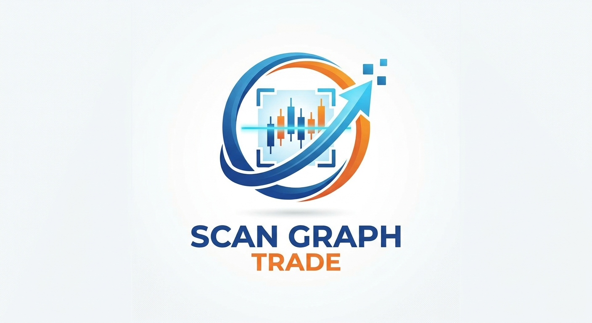
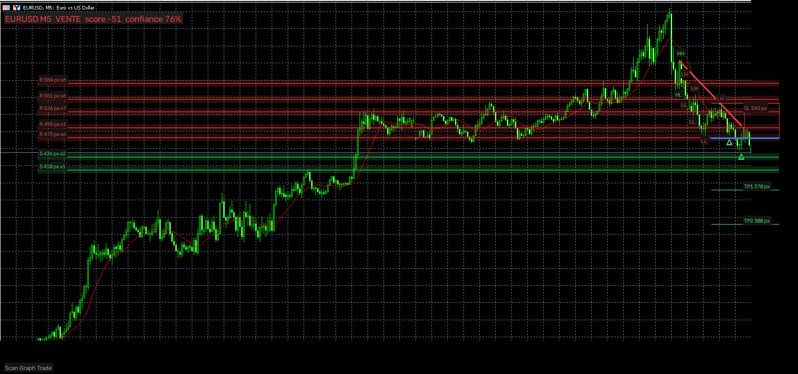
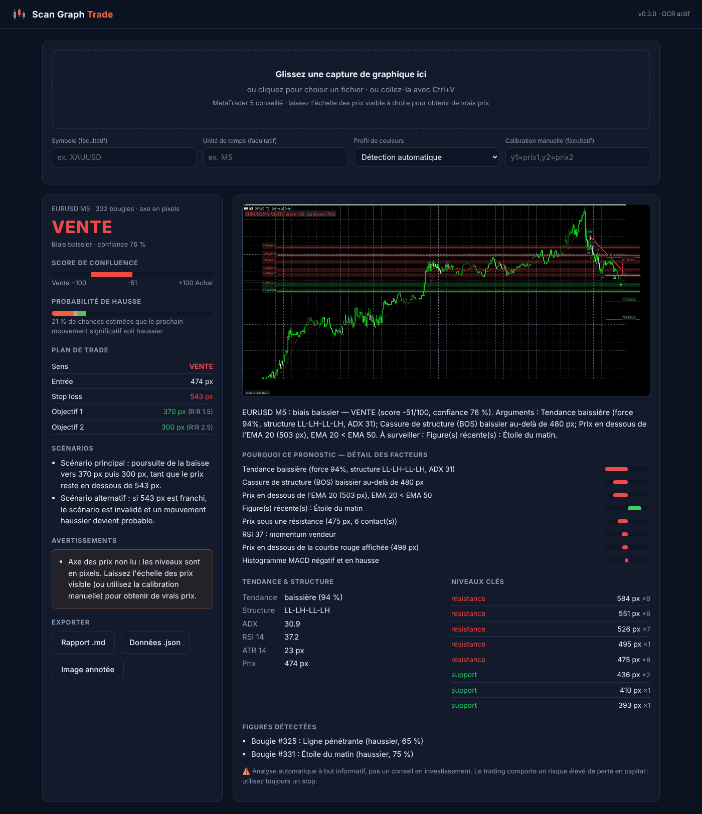

<p align="center">
  
</p>

<h1 align="center">Scan Graph Trade</h1>

<p align="center">
  <b>Logiciel de trading intelligent qui scanne et analyse les captures d'écran de graphiques boursiers.</b><br>
  Chandeliers japonais · Structure de marché · Supports/résistances · Figures chartistes · Pronostic argumenté
</p>

<p align="center">
  
  
  
  
</p>

---

## 📌 Présentation

**Scan Graph Trade** transforme une simple capture d'écran (TradingView, MetaTrader 4/5, cTrader, application mobile de broker…) en **données exploitables** :

1. il **détecte chaque chandelier** (ouverture, plus haut, plus bas, clôture) par vision par ordinateur ;
2. il **lit le texte** de l'image par OCR (symbole, unité de temps, graduations de l'axe des prix) pour convertir les pixels en **prix réels** ;
3. il **analyse le graphique comme un trader** : tendance, structure (HH/HL/LH/LL, BOS, CHoCH), supports et résistances, obliques, figures chartistes et en chandeliers, indicateurs recalculés (EMA, RSI, MACD, ATR, ADX, Bollinger) ;
4. il **donne un pronostic argumenté** : ACHAT / VENTE / ATTENDRE, score de confluence, confiance, probabilité de hausse, plan de trade (entrée, stop, objectifs, R:R), scénario principal et alternatif ;
5. il **annote la capture** et **exporte** le tout (rapport Markdown, JSON, CSV) — en ligne de commande ou via une **interface web** en glisser-déposer.

<p align="center">
  
</p>

> ⚠️ Scan Graph Trade est un **outil d'aide à l'analyse**. Il ne constitue pas un conseil en investissement. Le trading comporte un risque élevé de perte en capital.

## ✨ Fonctionnalités

| Module | Description | Statut |
|---|---|---|
| 🕯️ **Détection des chandeliers** | Segmentation HSV (OpenCV), bougies pleines ou creuses, extraction OHLC | ✅ |
| 🟢 **MetaTrader 5** | Profils Green On Black / Black On White / couleurs perso, détection automatique | ✅ |
| 🔤 **OCR** | Axe des prix (prix réels), en-tête (symbole + unité de temps), tolérant aux erreurs de lecture | ✅ |
| 📐 **Figures en chandeliers** | 19 figures **selon le contexte** : marteau / pendu, étoile filante / marteau inversé, avalements, harami, ligne pénétrante, nuage noir, pinces, étoiles du matin / du soir, 3 soldats / 3 corbeaux, marubozu, doji | ✅ |
| 🧭 **Structure de marché** | Pivots zigzag filtrés par l'ATR, HH/HL/LH/LL, BOS et CHoCH, tendance + force (ADX) | ✅ |
| 🧱 **Supports / résistances** | Zones par regroupement des pivots, nombre de contacts, force, obliques de tendance | ✅ |
| 📊 **Figures chartistes** | Double sommet/creux, tête-épaules (et inversée), triangles, biseaux, canaux, rectangle — avec ligne de cou et objectif | ✅ |
| 📈 **Indicateurs** | EMA 20/50/200, RSI, MACD, ATR, ADX, Bollinger recalculés + moyennes mobiles **lues sur la capture** | ✅ |
| 🎯 **Pronostic** | Confluence pondérée → ACHAT / VENTE / ATTENDRE, confiance, plan de trade, scénarios, avertissements | ✅ |
| 🖼️ **Annotation** | Zones, obliques, pivots, figures, entrée / SL / TP dessinés sur la capture | ✅ |
| 🖥️ **Interface web** | Glisser-déposer ou Ctrl+V d'une capture, rapport complet, exports | ✅ |
| 💾 **Export** | Rapport Markdown, JSON complet, CSV des bougies | ✅ |
| 🧠 **Modèle IA** | Classification des figures par apprentissage automatique | 🔜 |
| 🔔 **Alertes** | Notifications Telegram / e-mail | 🔜 |

## 🗂️ Structure du projet

```
scan-graph-trade/
├── src/scan_graph_trade/
│   ├── analyzer.py          # Pipeline complet image → résultat
│   ├── cli.py               # Commande `sgt`
│   ├── models.py            # Candle, PatternMatch, AnalysisResult
│   ├── detection/           # Détection des chandeliers (OpenCV)
│   ├── ocr/                 # OCR + calibration de l'axe des prix
│   ├── patterns/            # Figures en chandeliers (avec contexte)
│   ├── analysis/            # Indicateurs, structure, niveaux, figures chartistes, pronostic
│   ├── report/              # Rapport texte/Markdown + annotation de la capture
│   ├── web/                 # Interface web (FastAPI + page glisser-déposer)
│   └── export/              # Export CSV / JSON
├── tests/                   # Tests unitaires (pytest, graphiques synthétiques)
├── docs/                    # Architecture, roadmap
├── assets/
│   ├── logo/                # Logo et icône
│   └── samples/             # Captures d'exemple
├── pyproject.toml
├── requirements.txt
└── requirements-dev.txt
```

## 🚀 Installation

### Prérequis

- **Python 3.10+**
- **Tesseract OCR** (facultatif mais recommandé, pour convertir les pixels en prix) :

| Système | Commande |
|---|---|
| Windows | Installer depuis [UB-Mannheim/tesseract](https://github.com/UB-Mannheim/tesseract/wiki) puis ajouter au `PATH` |
| Ubuntu / Debian / Kali | `sudo apt install tesseract-ocr` |
| macOS | `brew install tesseract` |
| Termux (Android) | `pkg install tesseract` |

### Installation du projet

```bash
git clone https://github.com/ck526438-lgtm/scan-graph-trade.git
cd scan-graph-trade

python -m venv .venv
# Windows : .venv\Scripts\activate
source .venv/bin/activate

pip install -e ".[web]"      # avec l'interface web
# ou : pip install -e ".[dev]" pour développer (tests, lint)
```

Ou, sans installation en mode paquet : `pip install -r requirements.txt`.

## 🧪 Utilisation

### En ligne de commande

```bash
sgt analyze capture.png                                   # rapport complet + pronostic
sgt analyze capture.png --annotate capture_annotee.png    # + capture annotée
sgt analyze capture.png --report analyse.md --json analyse.json --csv bougies.csv
sgt analyze capture.png --quiet                           # verdict seul (scripts, robots)
```

Exemple (capture `assets/samples/mt5_eurusd_m5.png`) :

```
SCAN GRAPH TRADE — EURUSD M5

=== PRONOSTIC ===
  • Verdict : VENTE  (biais baissier, score -51/100, confiance 76 %)
  • Probabilité estimée d'un prochain mouvement haussier : 21 %
  • Arguments : Tendance baissière (structure LL-LH-LL-LH, ADX 31); Cassure de structure (BOS)
    baissière; Prix en dessous de l'EMA 20, EMA 20 < EMA 50. À surveiller : Étoile du matin.
  • Scénario principal : poursuite de la baisse vers TP1 puis TP2, tant que le prix reste sous le stop.

=== PLAN DE TRADE ===
  • Entrée : dernière clôture · Stop : au-dessus du dernier sommet · Objectifs : R:R 1.5 et 2.5
...
```

Options utiles :

| Option | Rôle |
|---|---|
| `--profile` | Forcer un schéma de couleurs (sinon détection automatique) |
| `--axis "16=1.16540,684=1.15210"` | Calibration manuelle pixel → prix si l'axe n'est pas lisible |
| `--symbol XAUUSD --timeframe M5` | Forcer le symbole / l'unité de temps |
| `--no-ocr` | Désactiver Tesseract (niveaux exprimés en pixels) |

### Interface web

```bash
sgt serve            # puis ouvrir http://127.0.0.1:8000
```

Glissez une capture (ou collez-la avec **Ctrl+V**) : verdict, score, probabilité, plan de trade, scénarios, détail des facteurs, niveaux clés, figures et capture annotée, avec export Markdown / JSON / PNG.

<p align="center"></p>

## 🎯 Comment le pronostic est construit

Comme un analyste, le moteur ne se fie jamais à un seul signal. Chaque facteur vote entre −1 et +1, avec un poids :

| Facteur | Poids | Lecture |
|---|---|---|
| Tendance (structure + pente + EMA, modérée si ADX faible) | 2,0 | sens et force du marché |
| Figure chartiste confirmée / en formation | 2,0 / 1,0 | double sommet, tête-épaules, triangle… |
| Cassure de structure récente (BOS / CHoCH) | 1,5 | continuation ou retournement |
| Figures en chandeliers des 3 dernières bougies | 1,5 | renforcées ×1,5 si elles sont **sur une zone** |
| Moyennes mobiles (EMA 20/50) | 1,2 | position du prix, croisement |
| Emplacement (support / résistance à moins d'1 ATR) | 1,2 | acheter les supports, vendre les résistances |
| RSI, MACD | 1,0 | momentum, surachat / survente |
| Courbe tracée sur la capture, obliques, Bollinger | 0,6 – 0,8 | confirmation |

Le score (−100 à +100) donne **ACHAT** au-delà de +25, **VENTE** en dessous de −25, **ATTENDRE** sinon (seuil relevé à 35 en range). Le **stop** est placé derrière le dernier pivot ou la zone (entre 0,8 et 3 ATR), les **objectifs** sur la prochaine zone puis à 1,5 R et 2,5 R. Des **avertissements** signalent les situations à risque : peu de bougies, ADX faible, RSI extrême, R:R insuffisant, axe non calibré.

> Pour avoir de **vrais prix** (et non des pixels), laissez l'échelle des prix visible à droite de la capture : l'OCR la lit automatiquement.

### En Python

```python
from scan_graph_trade.analyzer import analyze_file
from scan_graph_trade.export import export_csv

from scan_graph_trade.report import render_report

result = analyze_file("capture.png")
fc = result.analysis["forecast"]
print(fc["verdict"], fc["score"], fc["confidence"], fc["plan"])
print(render_report(result))          # rapport complet en français

export_csv(result, "bougies.csv")
```

### 🟢 MetaTrader 5

Scan Graph Trade est optimisé pour les captures **MT5** (Fichier > Enregistrer sous image, ou capture d'écran classique). Le schéma de couleurs est **détecté automatiquement** :

| Schéma MT5 (clic droit > Propriétés > Couleurs) | Profil | Comment les bougies sont reconnues |
|---|---|---|
| **Green On Black** (défaut) | `mt5_green_on_black` | Contour vert ; haussière **creuse**, baissière **pleine blanche** |
| **Black On White** | `mt5_black_on_white` | Contour noir ; haussière **blanche**, baissière **noire** |
| Couleurs perso vert / rouge | `mt5_colored` | Couleur du corps |

```bash
sgt analyze capture_mt5.png                        # détection automatique
sgt analyze capture_mt5.png --profile mt5_green_on_black
```

Le logiciel ignore automatiquement l'en-tête (symbole, unité de temps), l'axe des prix, l'axe du temps, la grille et la ligne Bid. Il résiste aux captures compressées en JPEG (WhatsApp, Telegram).

**Conseils pour de meilleurs résultats :**
- capturez en **PNG** si possible et zoomez pour que les bougies fassent au moins 5 px de large ;
- masquez les indicateurs de même couleur que les bougies (ou analysez une capture sans indicateurs) ;
- gardez l'axe des prix visible : l'OCR s'en sert pour convertir les pixels en prix réels.

### Adapter les couleurs à votre plateforme

```python
from scan_graph_trade.detection import DetectorConfig
from scan_graph_trade.analyzer import analyze_file

config = DetectorConfig(
    bull_ranges=[((35, 60, 60), (100, 255, 255))],                          # vert
    bear_ranges=[((0, 80, 80), (25, 255, 255)), ((165, 80, 80), (179, 255, 255))],  # rouge
)
result = analyze_file("capture.png", config=config)
```

## ✅ Tests

```bash
pytest            # tests unitaires
pytest --cov      # avec couverture
ruff check src    # qualité du code
```

## 🛣️ Feuille de route

Voir [`docs/ROADMAP.md`](docs/ROADMAP.md) et [`docs/ARCHITECTURE.md`](docs/ARCHITECTURE.md).

## 🤝 Contribuer

1. Forkez le dépôt
2. Créez une branche : `git checkout -b feature/ma-fonctionnalite`
3. Commitez : `git commit -m "feat: ajoute ..."`
4. Poussez et ouvrez une Pull Request

## 📄 Licence

Distribué sous licence **MIT** — voir [`LICENSE`](LICENSE).

---

<p align="center">Développé par <b>Christ</b> · <a href="https://github.com/ck526438-lgtm">@ck526438-lgtm</a></p>
