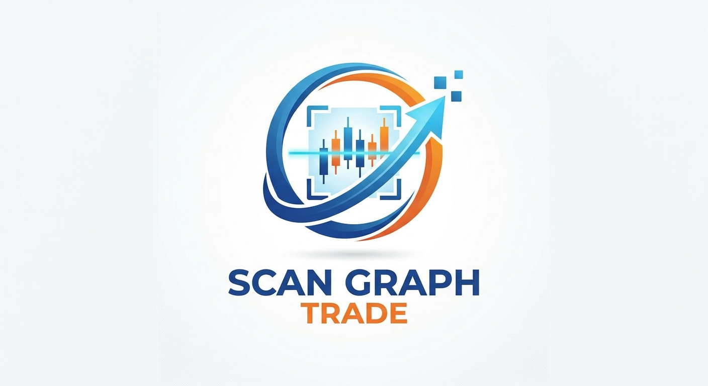

<p align="center">
  
</p>

<h1 align="center">Scan Graph Trade</h1>

<p align="center">
  <b>Logiciel de trading intelligent qui scanne et analyse les captures d'écran de graphiques boursiers.</b><br>
  Chandeliers japonais · OCR · Reconnaissance de figures · Export des données
</p>

<p align="center">
  
  
  
  
</p>

---

## 📌 Présentation

**Scan Graph Trade** transforme une simple capture d'écran (TradingView, MetaTrader 4/5, cTrader, application mobile de broker…) en **données exploitables** :

1. il **détecte chaque chandelier** (ouverture, plus haut, plus bas, clôture) par vision par ordinateur ;
2. il **lit le texte** de l'image par OCR (symbole, unité de temps, graduations de l'axe des prix) pour convertir les pixels en **prix réels** ;
3. il **reconnaît les figures** classiques de l'analyse technique ;
4. il **exporte** le tout en CSV ou JSON pour vos backtests, tableurs ou robots.

> ⚠️ Scan Graph Trade est un **outil d'aide à l'analyse**. Il ne constitue pas un conseil en investissement. Le trading comporte un risque élevé de perte en capital.

## ✨ Fonctionnalités

| Module | Description | Statut |
|---|---|---|
| 🕯️ **Détection des chandeliers** | Segmentation couleur HSV (OpenCV), extraction OHLC par bougie | ✅ v0.1 |
| 🔤 **OCR** | Lecture du texte (Tesseract) et calibration automatique de l'axe des prix | ✅ v0.1 |
| 📐 **Figures en chandeliers** | Doji, marteau, étoile filante, avalement haussier/baissier, trois soldats blancs / trois corbeaux noirs | ✅ v0.1 |
| 💾 **Export** | CSV (une ligne par bougie + figures) et JSON complet | ✅ v0.1 |
| 📈 **Indicateurs** | Détection des moyennes mobiles, RSI, MACD, volumes affichés sur la capture | 🔜 |
| 📊 **Figures chartistes** | Supports/résistances, triangles, double sommet/creux, tête-épaules | 🔜 |
| 🧠 **Modèle IA** | Classification des figures par apprentissage automatique | 🔜 |
| 🖥️ **Interface** | Application web / bureau avec glisser-déposer des captures | 🔜 |

## 🗂️ Structure du projet

```
scan-graph-trade/
├── src/scan_graph_trade/
│   ├── analyzer.py          # Pipeline complet image → résultat
│   ├── cli.py               # Commande `sgt`
│   ├── models.py            # Candle, PatternMatch, AnalysisResult
│   ├── detection/           # Détection des chandeliers (OpenCV)
│   ├── ocr/                 # OCR + calibration de l'axe des prix
│   ├── patterns/            # Reconnaissance des figures
│   └── export/              # Export CSV / JSON
├── tests/                   # Tests unitaires (pytest, graphiques synthétiques)
├── docs/                    # Architecture, roadmap
├── assets/
│   ├── logo/                # Logo et icône
│   └── samples/             # Captures d'exemple
├── pyproject.toml
├── requirements.txt
└── requirements-dev.txt
```

## 🚀 Installation

### Prérequis

- **Python 3.10+**
- **Tesseract OCR** (facultatif mais recommandé, pour convertir les pixels en prix) :

| Système | Commande |
|---|---|
| Windows | Installer depuis [UB-Mannheim/tesseract](https://github.com/UB-Mannheim/tesseract/wiki) puis ajouter au `PATH` |
| Ubuntu / Debian / Kali | `sudo apt install tesseract-ocr` |
| macOS | `brew install tesseract` |
| Termux (Android) | `pkg install tesseract` |

### Installation du projet

```bash
git clone https://github.com/ck526438-lgtm/scan-graph-trade.git
cd scan-graph-trade

python -m venv .venv
# Windows : .venv\Scripts\activate
source .venv/bin/activate

pip install -e ".[dev]"
```

Ou, sans installation en mode paquet : `pip install -r requirements.txt`.

## 🧪 Utilisation

### En ligne de commande

```bash
sgt analyze assets/samples/capture.png --json resultat.json --csv bougies.csv
```

Exemple de sortie :

```
Source       : assets/samples/capture.png
Bougies      : 48  (axe calibré : oui)
Figures      : 3
  - #12   hammer                 bullish  65%
  - #31   bearish_engulfing      bearish  75%
  - #47   doji                   neutral  60%
```

Options : `--no-ocr` pour désactiver Tesseract (les valeurs restent alors en coordonnées pixel).

### En Python

```python
from scan_graph_trade.analyzer import analyze_file
from scan_graph_trade.export import export_csv

result = analyze_file("capture.png")
for p in result.patterns:
    print(p.name, p.direction, p.confidence)

export_csv(result, "bougies.csv")
```

### Adapter les couleurs à votre plateforme

```python
from scan_graph_trade.detection import DetectorConfig
from scan_graph_trade.analyzer import analyze_file

config = DetectorConfig(
    bull_ranges=[((35, 60, 60), (100, 255, 255))],                          # vert
    bear_ranges=[((0, 80, 80), (25, 255, 255)), ((165, 80, 80), (179, 255, 255))],  # rouge
)
result = analyze_file("capture.png", config=config)
```

## ✅ Tests

```bash
pytest            # tests unitaires
pytest --cov      # avec couverture
ruff check src    # qualité du code
```

## 🛣️ Feuille de route

Voir [`docs/ROADMAP.md`](docs/ROADMAP.md) et [`docs/ARCHITECTURE.md`](docs/ARCHITECTURE.md).

## 🤝 Contribuer

1. Forkez le dépôt
2. Créez une branche : `git checkout -b feature/ma-fonctionnalite`
3. Commitez : `git commit -m "feat: ajoute ..."`
4. Poussez et ouvrez une Pull Request

## 📄 Licence

Distribué sous licence **MIT** — voir [`LICENSE`](LICENSE).

---

<p align="center">Développé par <b>Christ</b> · <a href="https://github.com/ck526438-lgtm">@ck526438-lgtm</a></p>
